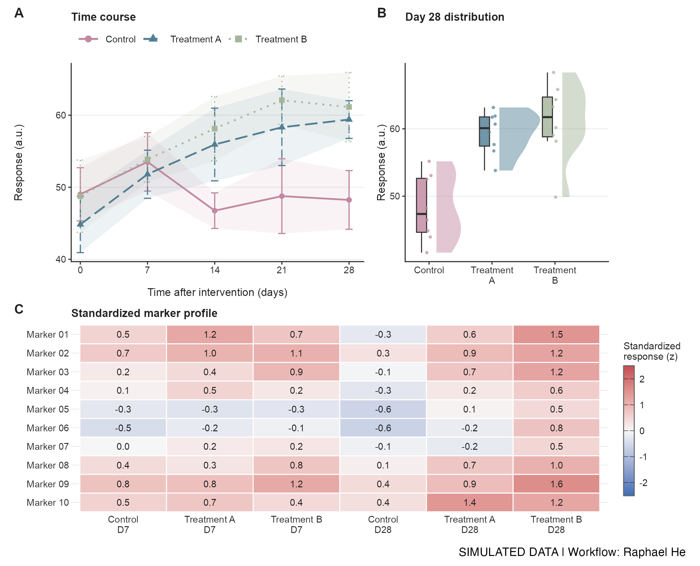
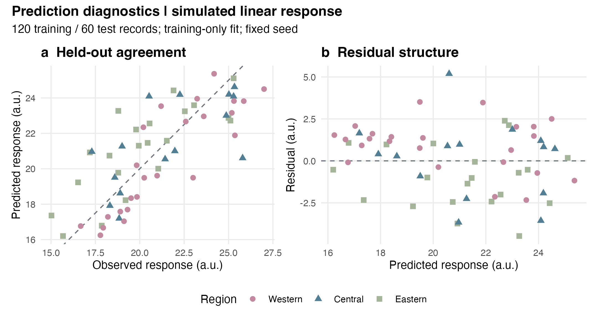
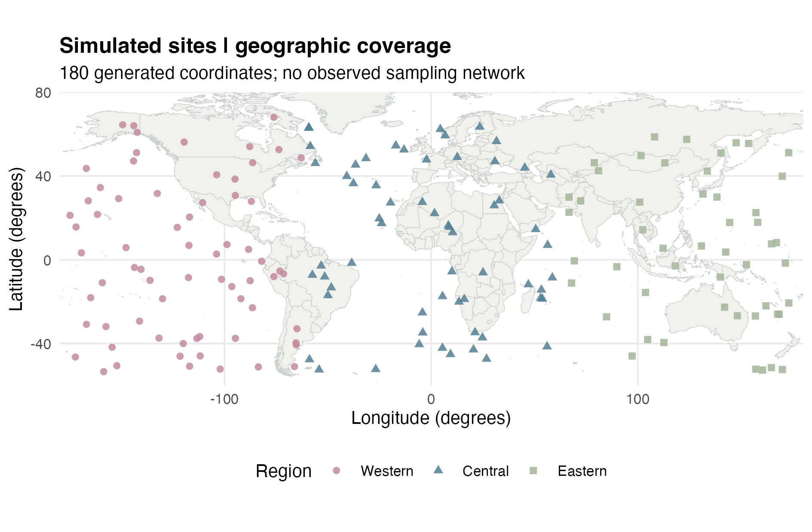

# Academic Figure · 科研绘图工作流

**维护与工作流整合 · Raphael He · v0.1.6-beta · 2026-11-26**

把数据、字段说明和研究问题交给 Codex，或指出已有图稿要改的地方。Academic Figure 会先检查所选绘图环境，再按任务选图、制图和核验导出。整套图共用一次选定的配色。

**完整试用**　解压后打开 `START.html`，可看示例、选图型、把 skill 安装到自己的 Codex。 [下载完整试用包](https://github.com/Raphael-He01/academic-figure/releases/download/v0.1.6-beta/Academic-Figure-Trial.zip)

**只选配色**　解压后打开 HTML 可搜索 13 套色卡，PNG 方便在手机上查看。浏览只需浏览器。 [下载离线色卡](https://github.com/Raphael-He01/academic-figure/releases/download/v0.1.6-beta/Academic-Figure-Palettes.zip)

上述下载地址对应 GitHub 的版本附件，随该版本公开时启用。源码用户也可以[从当前版本构建离线包](#构建与发布)。Raphael He 整合与维护，原创部分按 Apache-2.0 发布，部分上游资料适用 CC BY-NC 4.0。 [第三方材料范围](THIRD_PARTY_NOTICES.md)

## 从当前任务开始

| 你手里有什么 | 可以直接这样说 | 流程从哪里开始 |
|---|---|---|
| 数据、字段说明和一个研究问题 | “比较这几组的差异，保留原始观测。” | 核对每行代表什么、组间是否配对，再完成五点图稿契约与选图。 |
| 同一研究的一套图 | “做一套图。整体趋势和个体差异各画一张。” | 整套共用数据定义、组名和第六步选定的色卡，每张图分别说明要回答的问题。 |
| 已有工程和一次修改 | “继续上次的图，只把图例移到下方。” | 从现有源码、配置和最近导出接手。改布局后重看图例、边界和最终导出；更换数据时再回到数据核对。 |
| 待检查的成稿或参考图 | “检查这份 PDF 的字号、间距和字体。”或“学习这个局部放大的构图。” | 审图从实际成稿开始，学习从图像与图注开始。只具备图像时，核验范围限于可见内容。 |

[完整工作流程](SKILL.md) · [32 类图型及其条件](references/figure-family-index.md) · [实际导出验收](references/rendered-qa.md)

## 安装与首次运行

1. 将试用包中的 `academic-figure` 文件夹复制到个人技能目录。macOS/Linux 通常为 `~/.codex/skills/`，Windows 通常为 `%USERPROFILE%\.codex\skills\`。配置了 `CODEX_HOME` 时用其下的 `skills` 目录。已有同名安装先备份，然后在新会话中调用 skill。
2. 第一次可以直接说 **“使用 $academic-figure，先帮我检查并装好首次绘图需要的软件和包，然后继续做我的图。”** 助手检查所选路线和项目配置，说明缺项与安装位置，完成已授权的补装后复检，沿用本次任务、数据和色卡。只看离线示例或色卡可以直接打开网页。
3. 想先跑内置示例时，在 skill 根目录执行下方两行。Windows 可用 `py -3`。检测工具需要 Python 3.10+。缺软件时按[首次环境配置](references/first-run.md)选择对应平台的安装路径。

```sh
python3 scripts/check_environment.py --route rstudio --json
# 如检测报告缺少 R 或 RStudio，且同意安装，执行下一行后再建工程
# python3 scripts/check_environment.py --route rstudio --install-missing --json
python3 scripts/scaffold_project.py MyFirstFigure
```

打开 `MyFirstFigure/Academic-Figure.Rproj`，在该项目的 RStudio 控制台检查项目依赖。工程内附有检查脚本：

```r
source("scripts/check_r_project.R")
check_figure_environment()
# 若报告缺少依赖并希望安装，再运行 check_figure_environment(install = TRUE)
```

项目检查就绪后运行 `source("R/run_example.R")`。第一张图在 **`output/previews/academic_figure_example_preview.png`**。内置示例生成带标识的模拟数据，交给助手的真实绘图任务使用你提供的数据。R 锁文件记录版本 4.6.1。使用 Origin 需用户自己的 Windows 安装和许可。

## 示例预览







以上均为模拟数据演示；源代码、数据及图注在 examples 中。预览不代表所有验收层已通过。

## CSV 数据预检

`python3 scripts/profile_csv.py <数据.csv> --key <已确认的主键列>` 可只读扫描 UTF-8 CSV；复合主键可重复使用 `--key`，不指定主键则不判断重复记录。结果输出到终端，包含输入文件 SHA-256、字段空值、可解析数值、非有限数和主键重复计数。需要保存时可将输出重定向到新的文件。空白以外的缺失编码、单位、样本独立性及字段实际含义仍需核实；预检不会自动认定数据适合某种图形。

选图时先查 V01–V32 的研究问题与使用条件。例如在仓库根目录运行 `python3 scripts/figure_routes.py 变点` 或 `python3 scripts/figure_routes.py V06`，可以查到候选画法、所需证据及数据不足时的替代方案。 [32 类图型索引](references/figure-family-index.md) · [检索脚本](scripts/figure_routes.py)

已有经原表和方法核实的布尔事实时，可一次检索并核对首选画法，例如 `python3 scripts/figure_routes.py V08 --facts facts.json`。V03、V04、V06、V08、V09 有直接对应的规则。其他条目列出需要人工核对的条件。检索命中时命令返回 0，证据是否齐全见输出；自动化需要依返回值判断条件是否满足时，使用 `python3 scripts/chart_guard.py stage_flow facts.json`。该工具独立支持九类检查，`--list` 列出字段。 [条件检查脚本](scripts/chart_guard.py) · [阶段汇总与真实转移的对照练习](examples/stage-flow/compare.py)

## 选择与保存配色

浏览器直接打开 [本地色卡库](assets/palettes/catalog.html)，无需服务器。13套候选组合，默认推荐雾海玫瑰。每套图确认一次；指定/已确认或明确委托选择后不重复询问。类别、连续量和正负偏差需要各自正确的颜色语义。

项目会保存色卡库副本。在中央配置中写一次整套的色卡和有序组名。各图按组名取色，图例可按所需顺序展示。在脚手架项目的 RStudio 中，例如：

```r
source("R/figure_config.R")
set_groups <- c("对照", "低剂量", "高剂量")
set_card <- "rose_mist"
whole <- figure_config(set_card, groups = set_groups)
followup <- figure_config(set_card, groups = c("高剂量", "低剂量"), set_groups = set_groups)
```

此例中，高剂量始终使用 `#A5B59A` 和方形标记。导出清单同时记录实际展示的颜色映射与整套映射。示例脚手架支持一至三组，老工程按其已有配置运行。色卡与类别数、测量尺度和实际图稿的可读性需分别核对。

## 使用 profile 与能力边界

| 功能/路线 | 本版状态 | 验收边界 |
|---|---|---|
| 数据检查、五点契约、选图及图注规则 | 可用工作流指南 | 需要真实字段定义；不能仅凭列名保证理解数据 |
| RStudio 制图 | 默认生产路线；有保存的 R 示例 | 需可访问 GUI，运行后检查真实导出 |
| 命令行/CI | 显式测试 profile | 用于代码回归与可复现性检查，不能冒充 RStudio GUI 验收 |
| Origin | 可选路线，已观察到本机 Windows 11 ARM64 中的 OriginPro 2026b 学习版启动 | 原生作图、保存和导出验收待完成 |
| 多种高级图型 | 条件式设计指南 | 不等于每种图型都有已测渲染器或统计引擎 |
| 面板对齐 | 平面 patchwork 的补充审计 | 嵌套、facet、固定比例、inset 等可能 NOT AUDITABLE，详见 [QA](references/rendered-qa.md) |
| DSH | 可选公共资料助手 | 不要求安装，不继承作者账户或授权，不处理私人材料 |
| 字体与导出 QA | 补充机械检查 | 不证明科研结论、符号完整性或最终美术效果 |

项目可在现有配置记录 `production_route=RStudio/Origin`、`execution_profile=interactive/test`、图注语言及配色选择。公开版不继承 Raphael 的个人持久授权。只有用户选择的 Origin 路线才使用其已有授权软件；购买、账号和安装另行处理。

## 完整演示与交付

新项目还包含 `R/plot_forest.R`、`R/plot_ternary.R` 和 `R/plot_spectra_network.R` 基础组件。通过 `source()` 加载后传入已核实的数据：森林图需要 `label, estimate, lower, upper`；三元图需要和为一的 `a, b, c`；光谱图需要 `sample_id, wavelength, value`；网络图需要节点 `id, x, y` 和边 `from, to`。网络组件用等宽连线展示连接关系。笛卡尔局部放大沿用主图数据、坐标方向和纵横比。投影地图需使用能处理其坐标参考系的定位框。图注、单位、区间含义和最后排版仍须补充与检查。

`scripts/figure_evidence.py` 可在同一目录树内绑定一份数据文件、一份图和一份图注的哈希：运行 `create <记录.json> --data <数据> --figure <图> --caption <图注>`，之后运行 `verify <记录.json>` 检查文件是否变化。结果只证明文件版本一致，不核对图注数字；多输入或多面板项目需逐项记录或采用更完整的项目清单。

对适合模板化的图注，可用 `scripts/caption_facts.py render <模板> <事实.json> <新图注>` 从已核实的字符串事实生成；模板使用 `${n}` 等占位符，JSON 例如 `{"n":"12"}`。用 `verify` 代替 `render` 检查当前事实与图注是否一致。该方法不会计算或验证统计结果，也不能检查未使用占位符的自由文本。

- [统计多面板示例](assets/r-template/R/run_example.R)：模拟趋势、分布、热图；通过 scaffold 运行，包含数据验证、配置、图注和 PDF/SVG/PNG/TIFF。
- [空间与模型诊断演示](examples/run_demos.R)：同一模拟站点数据的全球点位、空间残差，以及独立样本的预测诊断；逐项标注模拟来源，输出数据、代码对应说明和图注。
- 在 RStudio 从仓库根目录运行 `source("examples/run_demos.R")`。输出写入 `artifacts/demos/`，不覆盖用户输入。重复执行使用新的时间戳目录。

另有两份可直接打开的模型图，均使用模拟数据。

| 演示 | 可观察的细节 | 文件 |
|---|---|---|
| 加权状态分布 V04 | 每列表示一个时点，色深表示每个状态区间的概率。第 24 步没有可用状态样本，用叉号单独标出。 | [矢量图](examples/model-output/preview/state-mass.svg) · [逐时点核对表](examples/model-output/preview/mass-summary.csv) · [用自己的数据绘制](references/weighted-state-fields.md) |
| 样本特征图谱 V06 | 每列保留一个站点的四次模拟温度偏差。顶部标注分组和代表站点，缺测与实测零值分开显示。 | [矢量图](examples/model-output/preview/sample-atlas.svg) · [逐单元核对表](examples/model-output/preview/atlas-cells.csv) · [用自己的数据绘制](references/sample-atlas.md) |

重绘这两份演示时，在仓库根目录打开 RStudio，运行下面两行，输出 SVG、PNG 和 CSV。目录名可换为任意尚未存在的路径。 [演示代码](examples/model-output/render.R)

```r
source("examples/model-output/render.R")
render_model_examples("my-previews")
```

导出成功初始状态为 pending。新脚手架的 `output/qa/export_manifest.csv` 记录设备、配色与各层验收状态。从项目根目录运行 `python3 <技能目录>/scripts/reconcile_export_status.py output/qa/export_manifest.csv`，更新文件/字体证据。未嵌入字体为 failed；清单路径支持跨工作目录调用；特殊目录结构可用 `--project-root` 指定项目根目录。文件哈希变化会使既有人工检查失效；人工记录应在同一清单的 `review_sha256` 绑定实际文件版本。清单尺寸也参与机械检查。机械通过后科学/视觉检查仍待完成。没有合格 PDF 时保留 SVG 并按目标要求选择已验证的 PDF 设备，不能把基础 Helvetica PDF 当成已嵌字投稿稿。

当常用 PDF 设备漏字时，可用本机 Chromium 浏览器和 PyMuPDF 由自包含的 svglite 文件生成校样。工具会检查单页、输出尺寸、字体嵌入和指定字符串的逐字提取。部分字体需要从本机可嵌入的字库选取字形。浏览器可能舍入纸张尺寸，每份校样仍需逐图复查。 [混排 PDF 操作说明](references/r-workflow.md#mixed-script-export-check)

## 检查实际图稿的色觉差异与灰度

`python3 scripts/render_colour_review.py examples/gallery/statistical_panels.png <新检查目录>` 会调用现有 R colorspace 对完整的不透明 RGB 图像生成 deutan、protan、tritan 和灰度副本；额外依赖为 PyMuPDF、Rscript、colorspace、jsonlite，无需另装 PNG 包。记录绑定原图和副本 SHA-256，目录已存在时拒绝覆盖。缺依赖明确返回不可审计。

这些副本供逐面板检查，不能替代原稿或证明所有读者都能分辨。当前统计演示依靠线型/点形、直接组名和热图数值标注补充颜色：灰度下不能只靠热图深浅判断正负。详见 [配色检查记录](examples/gallery/colour-review/REVIEW.md)。

脚手架的色卡质检图会为每格 HEX 值计算黑字和白字的对比度并采用较高的一项。色差报告列出原色、三类色觉模拟和灰度。只用一组时，组间色差显示为「不适用」。

## 构建与发布

在源码根目录用 Python 3.10+ 执行。输出目录放在仓库外，选用一个尚未存在的目录。

```sh
python3 -m pip install -r requirements-qa.txt
python3 scripts/build_distribution.py ../academic-figure-downloads
```

交付目录包含完整试用 ZIP、独立色卡 ZIP、下载校验和以及可部署的 `site/`。打开试用包的 `START.html`，或用浏览器直接打开 `site/index.html`。生成文件全部取自当前源码版本。

维护者推送与 `VERSION` 匹配的 `v` 前缀标签后，**Build tagged beta downloads** 生成含两份附件和校验和的草稿。审核该标签的 **Release regression** 结果与附件，再发布草稿。更换仓库或版本时，同步首页的两个带标签下载地址。要启用在线色卡，在仓库的 Settings → Pages 选择 GitHub Actions，运行 **Publish palette site**。部署地址显示在该次工作流的 github-pages 环境中。 [GitHub Pages 部署说明](https://docs.github.com/en/pages/getting-started-with-github-pages/using-custom-workflows-with-github-pages)

## 验证、升级与反馈

运行 `python3 -B -m unittest discover -s tests -v` 进行回归检查。缺少依赖的项目会标为 SKIP。浏览器测试需要设置 `ACADEMIC_FIGURE_CHROMIUM` 为本机可执行文件路径。CI 配置覆盖三种系统的常规回归、Python 3.10，以及 Ubuntu 中安装完整绘图依赖与 Chrome 的渲染作业。完整作业要求测试实际运行，出现跳过会返回失败。

扩展分享包时，运行 `python3 scripts/package_release.py <源目录之外的新 ZIP 路径>`。工具按公开目录清单收集文件，跳过 R 会话输出、依赖缓存和已有的包内清单。ZIP 内含逐文件 SHA-256 校验记录。

测试覆盖防覆盖、空格路径、色卡绑定/未知卡/类别超限、缺依赖、坏输入、碰撞、未嵌字字体和断链。真实最终尺寸、所有面板、CVD/灰度、科学语义及复杂布局仍需人工或可观察 GUI 检查。参见 [发布验证记录](VALIDATION.md)。

升级：先备份已安装 skill，使用新发行版替换技能文件；保留独立项目和固定色卡版本。卸载：备份后移除对应 skill 目录，项目文件可继续保留。反馈请提供版本、系统、最小脱敏数据、实际/预期行为、错误和 QA 状态；不要提交账号、私密研究数据或原始个人路径。

## 许可、署名与参考资料

原创代码/文字按 Apache-2.0 发布，**第三方派生文件另按其对应条件**；整包含 CC BY-NC 内容，不应宣传为全包 MIT/Apache 或无商用限制。逐文件范围见 [第三方说明](THIRD_PARTY_NOTICES.md) 和 [Apache 许可](LICENSE)、[CC BY-NC 文本](LICENSES/CC-BY-NC-4.0.txt)。Raphael He 是整合与维护者，保留上游作者署名；AI 辅助实现与编辑不代表新增科学证据。

不捆绑原始论文图或私人 ICM 观察。期刊规范是带日期参考，投稿前重查。色卡源图权利尚未独立核实，记录的是明确色值与重新编写的设计说明，不附原海报，不称为全部原创或普遍可访问性认证。
